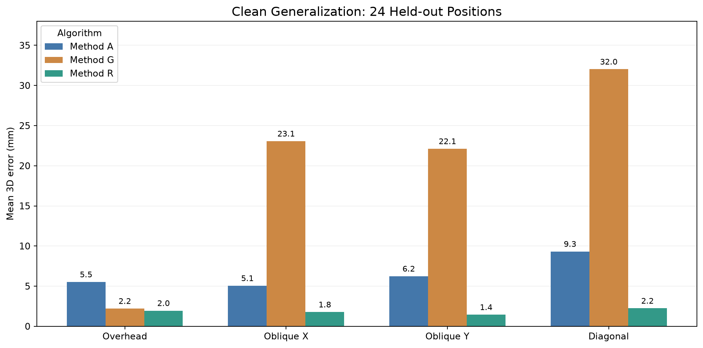
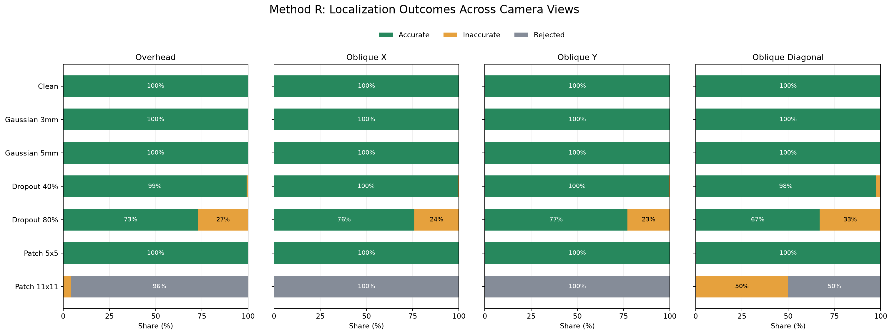

# RGB-D Perception for Robotic Reaching

**Simulation-based 3D object localization, error diagnosis, and robustness evaluation**

This project develops and evaluates an RGB-D perception pipeline that estimates the **3D World-coordinate position of a target object's top-face center** from rendered color and depth images. Starting with camera geometry and color-based object detection, the work progresses through systematic error analysis, robust depth estimation, and evaluations under unseen positions, altered camera viewpoints, and corrupted depth measurements.

The project is intended as a reproducible, research-oriented exploration of **robot perception and 3D computer vision**. Although reaching motivates the choice of target point, the current implementation **stops at 3D target localization**: robot-arm inverse kinematics, motion planning, and reaching success have **not** yet been implemented or evaluated.

## Highlights

- Built an RGB-D pipeline from **camera intrinsics and extrinsics** to a 3D target in World coordinates.
- Reduced mean 3D localization error from **4.903 mm (baseline A)** to **0.463 mm (method G)** on nine original clean overhead scenes—a **90.55% reduction**, measured on development scenes.
- Developed a robust estimator (**method R**) using depth median/MAD filtering, a continuous surface centroid, and explicit validity checks.
- Evaluated **33 positions × 4 camera viewpoints = 132 clean scenes**. Method R returned a position within the experimental 5 mm tolerance in all 132 cases, including 96 scenes involving previously unseen positions.
- Stress-tested the frozen methods on **4,128 clean/corrupted input scenarios**, producing **12,384 paired localization predictions** on 96 held-out position/viewpoint combinations.
- Identified **failure mechanisms**, not just average error: nearest-depth selection biases under oblique views, inaccurate returns under severe depth dropout, and limitations of bounding-span confidence checks.

> **Scope of the evidence:** All results come from a controlled **PyBullet TinyRenderer simulation** of one red cube. A 5 mm localization threshold is an evaluation convention, **not** a guarantee of robot safety or reaching accuracy.

## Research questions

1. How can RGB pixels and metric depth be transformed reliably into 3D World coordinates?
2. Why do object masks, surface selection, and camera conventions introduce systematic localization error?
3. How do Gaussian depth noise and missing-depth patterns affect accuracy and the ability to reject unreliable estimates?
4. Does a robust localization method retain accuracy at **unseen object positions** and **oblique camera viewpoints**?
5. Under what conditions does a method **return an inaccurate coordinate** instead of explicitly **rejecting** an estimate?

## Perception pipeline

```text
PyBullet RGB-D scene (5 cm red cube, known camera configuration)
          │
          ├── RGB image ──► red-object mask ──────────┐
          └── depth buffer ──► metric depth image ────┤
                                                     ▼
                               depth-supported surface selection
                                                     │
                                        surface pixel (u, v)
                                        + optical-axis depth
                                                     │
                                                     ▼
                               pixel ──► optical camera 3D
                                                     │
                                                     ▼
                               optical ──► OpenGL camera 3D
                                                     │
                                                     ▼
                               inverse view transform ──► World 3D target
                                                     │
                                                     ▼
                               Ground-truth comparison (evaluation only)
                                                     │
                                                     ▼
                               accuracy, failure, and robustness analysis
```

The estimator uses **RGB, metric depth, camera intrinsics, and the camera view matrix**. The simulator's true cube pose and segmentation IDs are used for **ground-truth calculation and diagnosis**, not as inputs to the color-based target detector.

### Camera and geometry

- **Simulator / renderer:** PyBullet, CPU TinyRenderer (`DIRECT` mode).
- **Target:** Red cube, edge length **0.05 m**, resting on a horizontal plane.
- **Image:** **320 × 240** RGB-D pixels, vertical field of view **60°**.
- **Depth:** PyBullet depth buffer converted to **metric optical-axis depth**; clipping planes **0.05 m** and **2.0 m**.
- **Coordinates:** Optical frame (X right, Y down, Z forward) → OpenGL camera frame → World frame using the inverse of the PyBullet view matrix.
- **Ground truth:** Cube **top-face center** in World coordinates, computed from the simulated object pose and orientation—not the cube's geometric center.

The clean overhead reference camera is located at `(0, 0, 1.0)` m and points toward the World origin. Generalization experiments also use oblique X, oblique Y, and diagonal views, each directed toward the origin at a fixed **1 m eye-to-origin distance**.

## Localization methods

| Method | Surface and pixel selection | Depth estimation | Validity checks |
|---|---|---|---|
| **A — Baseline** | RGB mask; integer pixel near mask centroid; no vertical correction | Median of valid RGB-mask depths | Fails if no usable pixels |
| **G — Minimum-depth selection** | RGB pixels within **1 mm of the minimum valid depth**; integer selected pixel; empirical `+1` vertical pixel offset | Median of selected depths | Fails if selected surface is empty |
| **R — Robust surface estimator** | Depth median/MAD inliers; **continuous** inlier centroid; same `+1` vertical pixel offset | Median of inlier depths | Minimum **10** valid/inlier pixels and **50%** horizontal/vertical support spans |

The `+1` vertical-pixel correction was found empirically when diagnosing the TinyRenderer projection/rasterization alignment; **it is not a general camera calibration rule**. A, G, and R are whole-pipeline configurations, so their comparisons do **not** isolate the effect of each individual component. Their parameters were frozen for the held-out Day 8 experiments.

## Project development: Week 0–Day 8

| Stage | Implementation / investigation | Outcome |
|---|---|---|
| **Week 0** | PyBullet scene, virtual camera, RGB/depth/segmentation rendering, metric depth, GT export | Reproducible synthetic RGB-D inputs |
| **Day 1** | Camera intrinsic matrix and pixel-to-camera back-projection | Numerical geometry checks and tests |
| **Day 2** | Optical, OpenGL-camera, and World coordinate transformations | End-to-end 3D back-projection and round-trip validation |
| **Day 3** | RGB red-object masking and mask-based pixel selection | Object localization region extracted without GT segmentation |
| **Day 4** | Single-pixel and median-neighborhood depth localization; missing-center recovery | Initial 3D object localization with depth-failure handling |
| **Day 5** | Nine-position evaluation and error metrics | Initial localization error dataset |
| **Day 6** | GT reprojection, segmentation alignment, side-face diagnosis, eight-variant ablation | Baseline 4.903 mm → method G 0.463 mm mean error on development scenes |
| **Day 7** | Gaussian noise, random/patch dropout, robust method R, outcome classification | A/G/R depth-robustness benchmark and failure analysis |
| **Day 8** | Held-out positions, four camera views, transferred corruption tests, surface-coverage and pixel-grid diagnostics | Generalization and remaining failure modes characterized |

## Experimental results

### 1. Clean localization: previously used vs. unseen positions

The nine development positions were used while designing the methods. The **16 interpolation** positions are new locations inside the previous XY bounds; the **eight extrapolation** positions lie modestly outside those bounds.

**Overhead camera — mean 3D error (mm):**

| Position group | Scenes | A | G | R | R within 5 mm |
|---|---:|---:|---:|---:|---:|
| Development reference | 9 | 4.903 | 0.463 | 0.463 | 9/9 |
| Held-out interpolation | 16 | 5.034 | 2.342 | **1.949** | 16/16 |
| Held-out extrapolation | 8 | 6.513 | 1.954 | **1.954** | 8/8 |

Method R satisfied the 5 mm criterion at all 24 new overhead positions. However, its mean error increased from **0.463 mm** on development positions to approximately **1.95 mm** at new positions. This is evidence of useful accuracy within the evaluated workspace—not unchanged submillimeter precision or unrestricted spatial generalization.

### 2. Clean localization: viewpoint generalization

The methods were evaluated at the **same 24 held-out positions** from four different camera views.

**Mean 3D error (mm), 24 positions per view:**

| Camera viewpoint | A | G | R | R within 5 mm |
|---|---:|---:|---:|---:|
| Overhead | 5.527 | 2.213 | **1.951** | 24/24 |
| Oblique X | 5.058 | 23.065 | **1.776** | 24/24 |
| Oblique Y | 6.243 | 22.118 | **1.447** | 24/24 |
| Oblique diagonal | 9.324 | 32.027 | **2.241** | 24/24 |

Across all **132 clean scenes** (including 36 development-position scenes), **method R returned a coordinate within 5 mm in every case**; its largest observed error was **3.994 mm**. In contrast, method G returned coordinates exceeding 5 mm in all **99 oblique-view scenes**.



**Why G degraded:** Under oblique viewpoints, its minimum-depth criterion concentrated selection on a small, camera-near portion of the observed surface. For the oblique-diagonal view on held-out scenes, G selected **3.0 pixels on average**, versus **124.0** for R; G's mean image-center residual was **6.815 pixels**, with **−7.884 mm** signed optical-depth bias. These diagnostics support a near-edge selection-bias explanation rather than a coordinate-frame failure.

[Inspect the selected-surface visualization](outputs/generalization_surface_selection.png)

### 3. Depth robustness on the original development scenes (Day 7)

Before evaluating unseen scenes, the methods were compared on the original **nine overhead positions** under controlled synthetic depth corruption. The initial paired robustness benchmark covered **1,314 input scenarios** and **3,942 A/G/R evaluations**; these are **development-set** results, not held-out generalization evidence.

**Mean 3D error (mm) under Gaussian depth noise:**

| Noise standard deviation | A | G | R |
|---|---:|---:|---:|
| 0 mm (clean) | 4.903 | 0.463 | 0.463 |
| 1 mm | 4.903 | 11.932 | **0.490** |
| 3 mm | 4.913 | 19.598 | **0.577** |
| 5 mm | 4.940 | 22.596 | **0.686** |

For **80% random depth dropout**, R's mean error over returned estimates was **3.408 mm**, but **18.9%** of inputs yielded an inaccurate return (>5 mm), not a rejection. Under an **11×11 centered missing-depth patch**, R rejected all **nine** development scenes instead of returning a coordinate; a subsequent held-out test revealed more complex failures under changed viewpoints.

[Gaussian noise comparison](outputs/robust_gaussian_error.png) · [Day 7 outcome classification](outputs/robust_localization_outcomes.png)

### 4. Depth corruption transferred to unseen positions/viewpoints (Day 8)

A returned estimate is classified as **accurate** when its 3D error is **≤ 5 mm**, **inaccurate** when it is **> 5 mm**, or **rejected** when no valid coordinate is produced. All cases—including rejections—are in the denominators of these rates. Mean / P90 / maximum errors are computed **over returned estimates only**.

The Day 8 transfer benchmark used **96 held-out position/viewpoint scenes**, seven corruption conditions, **4,128 input scenarios**, and **12,384 A/G/R evaluations**. Each corrupted RGB-D input was shared across the three methods; random corruptions used reproducible seeds.

**Method R, across all four camera views:**

| Input condition | Inputs | Accurate return | Inaccurate return | Rejected |
|---|---:|---:|---:|---:|
| Clean | 96 | 96 (100%) | 0 | 0 |
| Gaussian noise, σ = 3 mm | 960 | 960 (100%) | 0 | 0 |
| Gaussian noise, σ = 5 mm | 960 | 960 (100%) | 0 | 0 |
| Random depth dropout, 40% | 960 | 950 (99.0%) | 10 (1.0%) | 0 |
| Random depth dropout, 80% | 960 | 703 (73.2%) | **257 (26.8%)** | 0 |
| Centered 5×5 missing-depth patch | 96 | 96 (100%) | 0 | 0 |
| Centered 11×11 missing-depth patch | 96 | 0 | **13 (13.5%)** | **83 (86.5%)** |



**Important failure modes:**

- **Severe random dropout:** At 80% dropout, R returned an incorrect coordinate in **257/960 cases** without rejecting any estimate. Its minimum-count and span checks were not sufficient to detect all inaccurate returns.
- **Spatially incomplete depth:** Under an 11×11 patch, some retained inliers spanned most of the object's horizontal and vertical extent while filling little of the enclosed region. In **12 inaccurate oblique-diagonal cases**, mean normalized spans were **0.979 / 0.962**, but mean bounding-box fill was only **0.117**. This illustrates why separate width/height coverage tests can accept unrepresentative surface support.
- **Clean-image sampling bias:** On overhead scenes, R's residual error matched a centroid-only reconstruction while depth-only error was approximately zero. New-location image-centroid offsets averaged approximately **0.426–0.428 pixels**, consistent with pixel-grid/rasterization effects, but **not proof** that integer rounding alone caused the errors.

[Surface-coverage failure comparison](outputs/generalization_patch_coverage_comparison.png) · [Overhead centroid/depth diagnostic](outputs/generalization_overhead_error_components.png) · [Pixel-phase analysis](outputs/generalization_overhead_pixel_phase.png)

## Repository structure

```text
rgbd-perception-reaching/
├── src/
│   ├── generate_rgbd_data.py             # Initial scene renderer
│   ├── camera_geometry.py                # Intrinsics and coordinate transforms
│   ├── object_perception.py              # RGB color mask and pixel selection
│   ├── object_localization.py            # Initial depth-based localization
│   ├── generate_trials.py                # Nine original positions
│   ├── evaluate_trials.py                # Original nine-scene metrics
│   ├── diagnose_projection.py            # GT reprojection diagnosis
│   ├── run_ablation.py                   # Eight localization configurations
│   ├── analyze_ablation.py               # Ablation summaries and plots
│   ├── depth_corruption.py               # Gaussian noise and depth dropout
│   ├── robust_localization.py            # Robust estimator R
│   ├── evaluate_robust_methods.py        # Day 7 A/G/R benchmark
│   ├── visualize_robustness.py           # Day 7 figures
│   ├── generate_generalization_scenes.py # 33 positions × 4 viewpoints
│   ├── evaluate_position_generalization.py
│   ├── evaluate_viewpoint_generalization.py
│   ├── evaluate_generalization_robustness.py
│   ├── analyze_generalization.py
│   ├── diagnose_surface_coverage.py
│   └── diagnose_pixel_grid_bias.py
├── tests/                                 # Unit and evaluation-invariant tests
├── reports/
│   ├── rgbd_localization_error_analysis.md
│   ├── depth_robustness_evaluation.md
│   └── localization_generalization_evaluation.md
├── outputs/                               # Generated datasets, metrics, and plots
├── pyproject.toml
└── README.md
```

This is a **selected file map**, not an exhaustive listing of all diagnostic scripts. The original scene data live in `outputs/trials/`; the newer 132-scene benchmark has a generated manifest under `outputs/generalization/position_viewpoint_benchmark/`.

## Reproduction

### Prerequisites

- Python **3.11** (as required by `pyproject.toml`)
- [`uv`](https://docs.astral.sh/uv/) for dependency/environment management
- Python dependencies declared in `pyproject.toml` (including PyBullet, NumPy, Matplotlib, and pytest)

```bash
git clone https://github.com/SangzunPark/rgbd-perception-reaching.git
cd rgbd-perception-reaching
uv sync
```

Run commands from the **repository root**, in the order shown below. Rendering is CPU-based and does not require a graphical PyBullet window.

### A. Initial RGB-D pipeline and development scenes (Week 0–Day 5)

```bash
# Initial single scene (optional).
uv run python -m src.generate_rgbd_data

# Nine development scenes and their localization metrics.
uv run python -m src.generate_trials
uv run python -m src.evaluate_trials
```

### B. Error diagnosis and ablation (Day 6)

```bash
uv run python -m src.diagnose_projection
uv run python -m src.run_ablation
uv run python -m src.analyze_ablation
```

For the full range of camera-alignment and surface-geometry checks, see the diagnostic scripts and [Day 6 report](reports/rgbd_localization_error_analysis.md).

### C. Robustness benchmark (Day 7)

```bash
uv run python -m src.evaluate_gaussian_robustness
uv run python -m src.evaluate_missing_depth
uv run python -m src.evaluate_robust_methods
uv run python -m src.visualize_robustness
```

### D. Held-out generalization and diagnostics (Day 8)

**Important:** The original nine development scenes must exist before this stage; their overhead versions are **reused, not regenerated**.

```bash
# Add 123 new scenes; assemble a manifest referencing 132 total scenes.
uv run python -m src.generate_generalization_scenes

# Clean position and camera-viewpoint evaluation.
uv run python -m src.evaluate_position_generalization
uv run python -m src.evaluate_viewpoint_generalization

# Depth corruption transfer across held-out position/view combinations.
uv run python -m src.evaluate_generalization_robustness

# Generate failure-analysis plots and diagnostics.
uv run python -m src.analyze_generalization
uv run python -m src.diagnose_surface_coverage
uv run python -m src.diagnose_pixel_grid_bias
```

### E. Tests

```bash
uv run python -m pytest -q
```

**93 tests passed** in the completed local Day 8 run. Tests include camera geometry, missing-depth handling, paired-comparison integrity, output classification, reproducibility checks, and diagnostic invariants.

### Generated artifacts

- **Scene arrays:** RGB images, metric `depth_m.npy`, view matrices, GT top-face positions, and diagnostic segmentation images.
- **Development benchmarks:** `outputs/localization_ablation.csv`, `outputs/robust_localization_benchmark.csv`, and associated summary/plot files.
- **Generalization benchmarks:** `outputs/position_generalization_results.csv`, `outputs/viewpoint_generalization_results.csv`, `outputs/viewpoint_paired_deltas.csv`, and `outputs/generalization_robustness_results.csv`.
- **Diagnostic outputs:** geometry, surface coverage, and pixel-grid CSVs, alongside PNG figures.

Raw generated scenes under `outputs/trials/` and `outputs/generalization/` can be excluded from Git because the scripts regenerate them. The **source code, tests, reports, and selected result files** make the results auditable without checking in every rendered depth array.

## Reports

- **[RGB-D Localization Error Analysis](reports/rgbd_localization_error_analysis.md)** — systematic offsets, visible-side-face bias, and the initial ablation study (Day 6).
- **[Depth Robustness Evaluation](reports/depth_robustness_evaluation.md)** — Gaussian noise, random/patch dropout, and the development of R (Day 7).
- **[Generalization and Failure Analysis](reports/localization_generalization_evaluation.md)** — held-out positions, view changes, corruption transfer, coverage failures, and residual centroid error (Day 8).

## Limitations and next steps

This is a **simulation-only perception benchmark** with a single object shape and color, fixed imaging resolution, simplified depth corruption, and a small set of nearby camera poses. Repeated corrupted versions of one scene are **not independent new physical environments**. The selected `+1` pixel alignment adjustment and confidence thresholds are heuristic. None of the results establishes performance with real depth sensors, cluttered scenes, grasp planning, collision avoidance, or a physical robot.

The next natural step is to **connect perception to simulated robot reaching**: supply the World-frame target to an inverse-kinematics controller and compare **oracle-target vs. perception-target** end-effector outcomes using matched scenes. Additional future work includes geometry-aware surface-support checks, calibrated confidence/uncertainty, varied objects, and real-sensor validation.

---

*Research/learning implementation; no claim of novel state-of-the-art performance or completed robotic reaching control.*
