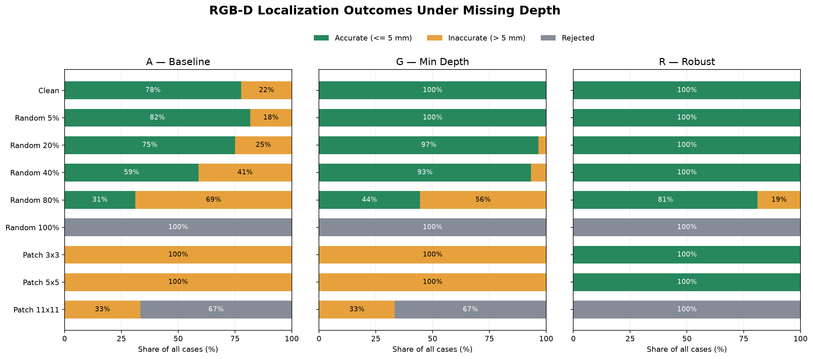

# Robustness Evaluation of RGB-D Object Localization Under Depth Corruption

## 1. Objective

Evaluate the robustness of an RGB-D object localization pipeline under synthetic depth measurement noise and missing-depth conditions, diagnose failure mechanisms, and investigate whether robust statistical estimation and spatial validity checks improve localization reliability.

## 2. Experimental Setup

- **Simulator:** PyBullet TinyRenderer
- **Camera:** Fixed overhead RGB-D camera, 320 × 240 resolution
- **Target:** 5 cm red cube
- **Ground truth:** Cube top-face center in World coordinates
- **Scenes:** Nine predetermined object positions
- **Noise conditions:** Zero-mean Gaussian noise with standard deviations of 0, 1, 3, and 5 mm
- **Missing-depth conditions:** Independent random dropout rates of 5%, 20%, 40%, 80%, and 100%, plus centered square patches of 3×3, 5×5, and 11×11 pixels
- **Evaluation:** Paired comparisons using identical corrupted depth inputs for each method

The benchmark contained 1,314 input scenarios and 3,942 localization evaluations, including clean scenes represented in both experiment groups.

## 3. Compared Localization Methods

**Method A — Baseline**

RGB threshold detection, integer-pixel selection, and median depth estimation over valid RGB-mask pixels, without the renderer-specific vertical alignment adjustment.

**Method G — Minimum-Depth Surface Filtering**

Depth-based top-face selection using the minimum valid depth and a fixed 1 mm threshold, followed by integer-pixel localization and an experimentally determined +1 pixel vertical adjustment.

**Method R — Robust Surface Estimation**

Median-based depth estimation, Median Absolute Deviation (MAD) filtering, continuous surface-centroid localization, and the same vertical alignment adjustment.

Method R also applied minimum valid-pixel and spatial coverage requirements, rejecting estimates when the remaining depth support was insufficient.

These are complete pipeline configurations. The comparison does not isolate the contribution of each component introduced in Method R.

## 4. Gaussian Depth Noise Results

| Noise σ | Method A | Method G | Method R |
|---|---:|---:|---:|
| 0 mm | 4.903 | 0.463 | 0.463 |
| 1 mm | 4.903 | 11.932 | 0.490 |
| 3 mm | 4.913 | 19.598 | 0.577 |
| 5 mm | 4.940 | 22.596 | 0.686 |

*Values represent mean 3D localization error in millimeters.*

Method G exhibited substantial degradation under Gaussian noise, while Method R maintained a mean error below 0.7 mm for all evaluated noise levels.

At σ=3 mm, Method R reduced mean localization error by approximately 97.1% relative to Method G.

### Failure Mechanism

The minimum-depth filter used by Method G became sensitive to extreme negative depth errors.

As noise increased, the number of selected surface pixels dropped from approximately 121 in clean scenes to only a few pixels in noisy scenes.

Method R retained approximately 121 surface pixels through its median- and MAD-based filtering strategy.

These observations support the hypothesis that unstable surface selection contributed substantially to Method G's localization errors.

**Figures**

- [Gaussian Noise — Mean Localization Error](../outputs/robust_gaussian_error.png)
- [Gaussian Noise — Selected Pixel Count](../outputs/robust_gaussian_selected_pixels.png)

## 5. Missing Depth Results

### 5.1 Random Depth Dropout

| Dropout | Method A | Method G | Method R |
|---|---:|---:|---:|
| 5% | 4.890 | 0.628 | 0.578 |
| 20% | 4.934 | 1.326 | 0.972 |
| 40% | 5.147 | 2.563 | 1.336 |
| 80% | 7.546 | 5.969 | 3.408 |
| 100% | N/A | N/A | N/A |

*Values represent mean 3D error among successful estimates, in millimeters.*

Method R consistently achieved lower mean error across the evaluated non-total dropout conditions.

At 80% random dropout, Method R achieved a mean error of 3.408 mm, with 81.1% of all estimates within the predefined 5 mm accuracy threshold.

All three methods rejected localization when 100% of the valid object depth measurements were removed.

### 5.2 Centered Patch Dropout

| Patch size | Method A | Method G | Method R |
|---|---:|---:|---:|
| 3×3 | 11.749 | 8.218 | 0.542 |
| 5×5 | 16.116 | 12.786 | 0.723 |
| 11×11 | 27.816 | 27.264 | N/A |

*Mean 3D error among successful estimates, in millimeters.*

For 3×3 and 5×5 patches, Method R retained low localization error despite the absence of valid depth at the target center.

This result is consistent with the benefit of estimating the continuous surface centroid separately from the depth measurements used for back-projection.

The 11×11 condition produced different outcomes:

- Methods A and G rejected six of nine estimates; the remaining three returned large localization errors.
- Method R rejected all nine estimates.
- Six Method R rejections were caused by insufficient valid object depth.
- Three Method R rejections were caused by insufficient spatial surface coverage.

Method R's rejection behavior prevented the return of poorly supported coordinates in these scenes, but it did not recover a valid target position. All three methods achieved a 0% within-5-mm rate in the 11×11 condition.

**Figures**

- [Random Dropout — Mean Error](../outputs/robust_random_dropout_error.png)
- [Missing Depth — Within 5 mm Accuracy](../outputs/robust_missing_depth_accuracy.png)
- [Patch Dropout — Failure Rate](../outputs/robust_patch_failure_rate.png)

### 5.3 Output Outcome Analysis: Accurate, Inaccurate, and Rejected Estimates

Mean localization error alone does not fully characterize the reliability of a perception pipeline. In a robotic application, returning an inaccurate target coordinate may have different consequences from explicitly rejecting an estimate.

To distinguish these outcomes, each evaluation was classified into one of three mutually exclusive categories:

1. **Accurate return:** A target coordinate was returned with a 3D error of 5 mm or less.
2. **Inaccurate return:** A coordinate was returned with a 3D error greater than 5 mm.
3. **Rejected estimate:** The method did not return a valid coordinate.

The 5 mm threshold was selected for this experimental analysis and does not represent a validated robotic safety requirement.

**Figure — Localization Outcome Classification**

The figure distinguishes accurate returns (≤5 mm), inaccurate
returns (>5 mm), and rejected estimates across the three methods.

It highlights that confidence-based rejection and localization
accuracy are different aspects of system reliability.

#### Results under missing-depth conditions

| Condition | Method | Accurate return | Inaccurate return | Rejected |
|---|---|---:|---:|---:|
| Patch 3×3 | A / G | 0% | 100% | 0% |
| Patch 3×3 | R | 100% | 0% | 0% |
| Patch 5×5 | A / G | 0% | 100% | 0% |
| Patch 5×5 | R | 100% | 0% | 0% |
| Patch 11×11 | A / G | 0% | 33.3% | 66.7% |
| Patch 11×11 | R | 0% | 0% | 100% |
| Random dropout 80% | A | 31.1% | 68.9% | 0% |
| Random dropout 80% | G | 44.4% | 55.6% | 0% |
| Random dropout 80% | R | 81.1% | 18.9% | 0% |

For centered 3×3 and 5×5 depth-dropout patches, Methods A and G returned coordinates for every scene, but none met the 5 mm accuracy threshold. Method R returned estimates within 5 mm for all nine scenes under both patch conditions.

For the 11×11 patch, Methods A and G each rejected six estimates and returned three inaccurate coordinates. Method R rejected all nine estimates, including the three scenes for which A and G returned highly inaccurate positions. This behavior demonstrates the operation of Method R's explicit validity checks, although no method recovered an accurate position in this condition.

Under 80% random depth dropout, Method R returned a coordinate for every evaluated input, but only 81.1% met the 5 mm accuracy threshold. The remaining 18.9% were inaccurate returns rather than explicit rejections.

These findings indicate that Method R's validity checks can reject some severely underconstrained measurements, but do not reliably detect every inaccurate estimate when depth observations are sparse or spatially uneven.

**Implication:** Further work should investigate uncertainty estimation, spatial support quality, and confidence calibration to distinguish reliable coordinates from inaccurate outputs before integrating the perception pipeline with robotic control.

## 6. Validation and Reproducibility

The evaluation included:

- 1,314 corrupted-input scenarios
- 3,942 localization evaluations across Methods A, G, and R
- Reproduction of 2,628 previously recorded Method A and G evaluations
- Verification that all three methods received the same input for each paired scenario
- 56 passing automated tests

All reported results were generated using scripted, reproducible experiments.

Primary scripts:

- `src/depth_corruption.py`
- `src/evaluate_gaussian_robustness.py`
- `src/evaluate_missing_depth.py`
- `src/robust_localization.py`
- `src/evaluate_robust_methods.py`
- `src/visualize_robustness.py`

## 7. Limitations

**Simulation scope:** The experiments used nine predetermined positions, a single cube, and a fixed overhead camera. Generalization to unseen scenes was not evaluated.

**Synthetic corruption:** Gaussian noise and independent pixel dropout are simplified corruption models. Real sensors may exhibit depth-dependent, spatially correlated, or material-dependent errors.

**Development and evaluation overlap:** Method R was designed after examining earlier errors on the same scenes. Reported improvements are therefore development-set results, not held-out generalization estimates.

**Combined algorithm changes:** Method R introduced multiple changes simultaneously. Additional ablation studies would be required to isolate the effects of MAD filtering, continuous centroid estimation, and confidence rules.

**Confidence criteria:** The minimum valid-pixel and spatial coverage thresholds are heuristic. Their reliability and appropriate calibration have not been established for real robotic operations.

**Renderer alignment:** The +1 pixel correction is specific to the investigated rendering configuration and should not be assumed valid for other cameras.

**Accuracy threshold:** The 5 mm threshold was selected for analysis; it does not establish a task-specific robotic safety requirement.

## 8. Conclusion

The experiments demonstrated that high localization accuracy under clean conditions did not guarantee robustness under corrupted depth measurements.

A minimum-depth-based localization method achieved submillimeter mean error on clean scenes but degraded substantially under Gaussian depth noise.

A robust estimator combining median/MAD filtering, continuous surface localization, and spatial validity checks retained clean-scene accuracy and substantially reduced localization error under the investigated synthetic corruption conditions.

The results establish a reproducible basis for subsequent evaluations of generalization across unseen positions, camera viewpoints, and object geometries.