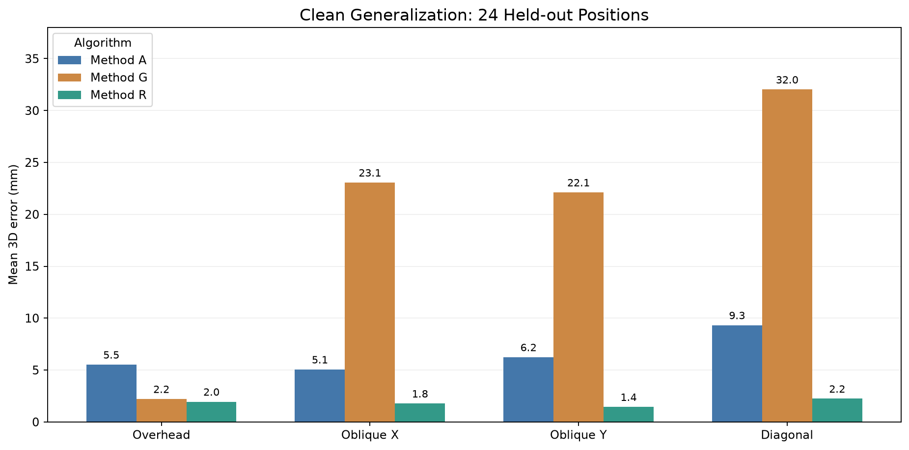
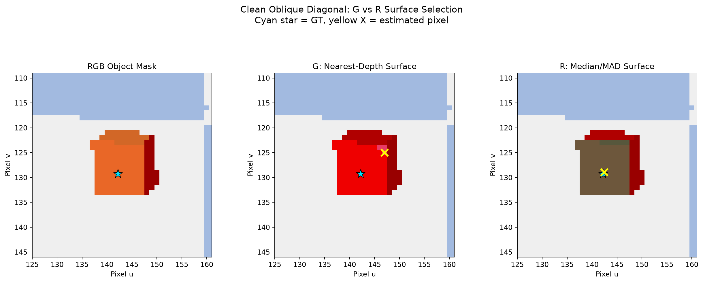
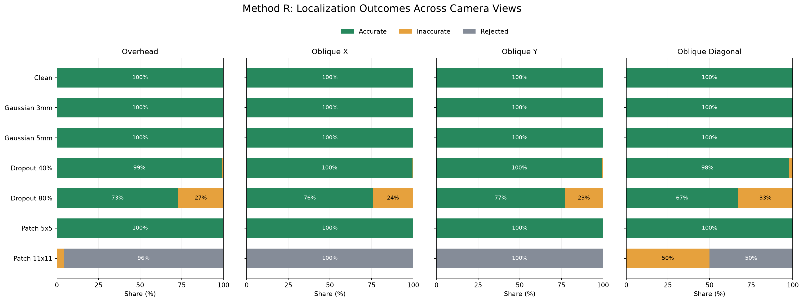
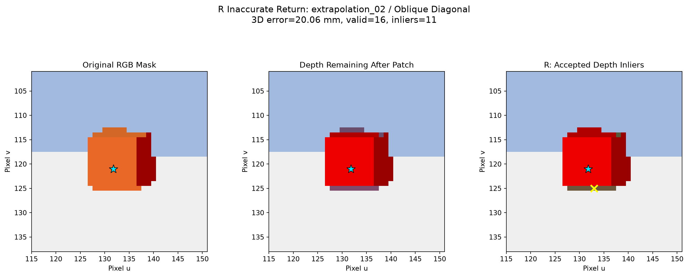
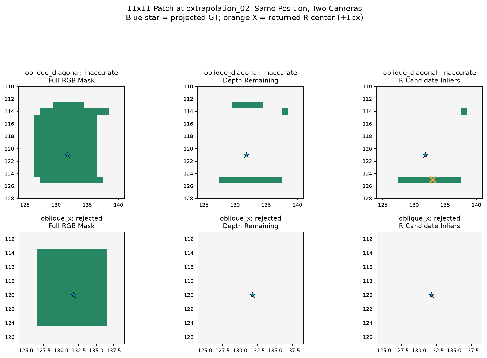
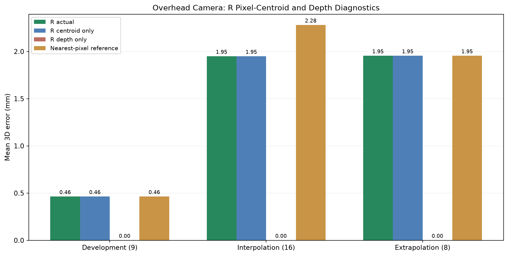
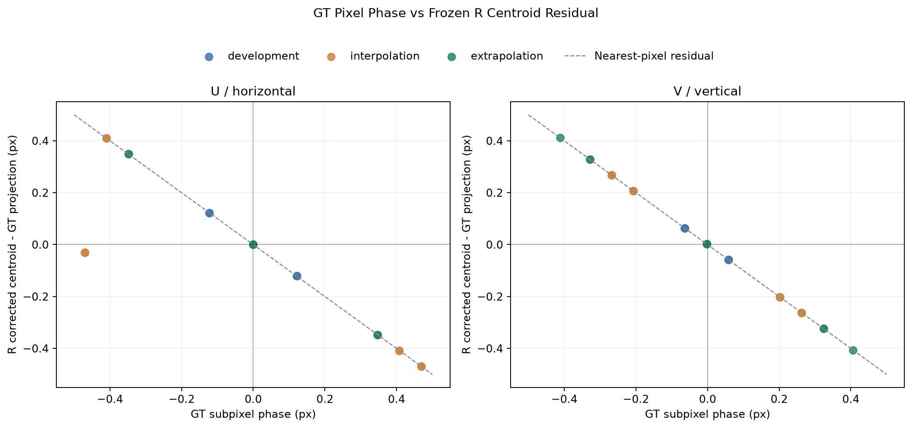

# Generalization and Failure Analysis of RGB-D Object Localization

## 1. Research Objective

This study evaluates whether RGB-D localization methods developed on nine simulated scenes retain their accuracy under **unseen object positions**, **changed camera viewpoints**, and **synthetic depth corruption**. It also investigates why a minimum-depth surface selector fails in oblique views and why a robust estimator can sometimes return inaccurate coordinates despite explicit validity checks.

The localization algorithms and their thresholds were **frozen before the held-out evaluations**. The existing nine development positions are reported separately from 24 unseen positions; ground truth is used for evaluation and diagnosis, not for estimating a target coordinate.

## 2. Experimental Design

### 2.1 Scene generation and ground truth

- **Renderer:** PyBullet TinyRenderer (CPU).
- **Target:** 5 cm red cube on a horizontal plane.
- **Image:** 320 × 240 pixels; vertical field of view 60°.
- **Ground truth:** World-coordinate position of the cube's top-face center, computed from its simulated pose and orientation.
- **Camera:** Four views directed toward the World origin, each approximately 1 m from that origin: overhead; oblique X; oblique Y; and oblique diagonal.

The evaluation comprised **33 positions × 4 camera viewpoints = 132 clean RGB-D scenes**:

| Position group | Positions | Role |
|---|---:|---|
| Development reference | 9 | Previously used for algorithm diagnosis and design; not a held-out test |
| Interpolation | 16 | Unseen positions inside the previous XY bounds |
| Limited spatial extrapolation | 8 | Unseen positions just outside those bounds |
| **Total** | **33** | **132 clean scenes across four views** |

Nine original overhead scenes were reused without modification, and 123 additional scenes were rendered. The 24 unseen positions across four views yield **96 held-out clean scenes**. The camera-view comparisons are paired by the same object position.

### 2.2 Frozen methods

- **A — RGB baseline:** Red-object RGB mask, integer pixel selection, and median valid object depth; no empirical vertical pixel correction.
- **G — Nearest-depth filtering:** Minimum valid object depth and a 1 mm surface-selection window; integer pixel selection; renderer-specific +1 vertical pixel correction.
- **R — Robust surface estimator:** Median and median absolute deviation (MAD) depth filtering, continuous inlier centroid, the same +1 vertical pixel correction, and minimum support/count and spatial-span validity checks.

The methods are distinct **pipeline configurations**, not an experiment isolating each individual modification. The +1 pixel adjustment is empirical and should not be interpreted as a universal camera geometry rule.

### 2.3 Outcome definitions

Each input produces one of three outcomes:

1. **Accurate return:** a 3D World coordinate is returned and its Euclidean error is **≤ 5 mm**.
2. **Inaccurate return:** a coordinate is returned with error **> 5 mm**.
3. **Rejected estimate:** no valid coordinate is returned.

Rates include **all input scenarios** in their denominator. Mean, P90 and maximum localization errors are calculated **only over returned estimates**; rejected cases are never assigned an artificial numerical error. The 5 mm criterion is an experimental threshold, **not a validated robotic safety requirement**.

## 3. Position Generalization Under the Overhead Camera

| Group | N | A mean error (mm) | G mean error (mm) | R mean error (mm) | R accurate returns |
|---|---:|---:|---:|---:|---:|
| Development reference | 9 | 4.903 | 0.463 | 0.463 | 9/9 (100%) |
| Interpolation | 16 | 5.034 | 2.342 | 1.949 | 16/16 (100%) |
| Extrapolation | 8 | 6.513 | 1.954 | 1.954 | 8/8 (100%) |

All 24 unseen overhead positions met the 5 mm criterion under Method R. Nevertheless, its mean error rose from **0.463 mm on development positions** to approximately **1.95 mm on unseen positions**. Thus, passing the predefined criterion does not imply unchanged submillimeter precision.

The inner and outer unseen groups had very similar R mean errors. These data do not establish that modest movement beyond the original XY bounds systematically increases the error. The outer group tests only a **limited spatial extrapolation**, not arbitrary workspace generalization.

## 4. Viewpoint Generalization Under Clean Depth

The four camera configurations were applied to the same 24 unseen positions. The following means pool the 16 interpolation and eight extrapolation positions, with each position weighted equally.

| Camera | A mean error (mm) | G mean error (mm) | R mean error (mm) | R accurate returns |
|---|---:|---:|---:|---:|
| Overhead | 5.527 | 2.213 | 1.951 | 24/24 |
| Oblique X | 5.058 | 23.065 | 1.776 | 24/24 |
| Oblique Y | 6.243 | 22.118 | 1.447 | 24/24 |
| Oblique diagonal | 9.324 | 32.027 | 2.241 | 24/24 |

Method R returned coordinates within 5 mm for **all 132 clean scenes** (including the development-reference group), with an observed maximum error of **3.994 mm**. Method G returned inaccurate coordinates in **all 99 oblique-view scenes**. These results demonstrate a strong difference in viewpoint tolerance **within the evaluated simulation configuration**.

### 4.1 Diagnosing G's oblique-view failure

Geometry diagnostics on the 96 held-out clean scenes compared selected-pixel centers with reprojected ground-truth centers, and selected depth with the ground-truth **optical-axis depth**.

| Camera | Method | Mean 2D center error (px) | Mean signed depth residual (mm) | Mean selected pixels |
|---|---|---:|---:|---:|
| Overhead | G | 0.484 | ~0.000 | 119.2 |
| Overhead | R | 0.427 | ~0.000 | 119.2 |
| Oblique X | G | 4.917 | −5.586 | 11.1 |
| Oblique X | R | 0.383 | −0.148 | 116.8 |
| Oblique Y | G | 4.704 | −5.346 | 11.0 |
| Oblique Y | R | 0.313 | +0.072 | 114.9 |
| Oblique diagonal | G | 6.815 | −7.884 | 3.0 |
| Oblique diagonal | R | 0.479 | +0.197 | 124.0 |

G's nearest-depth selection became concentrated in far fewer pixels in the oblique views; its selected center shifted away from the projected target center, while its signed depth residual was consistently negative (closer to the camera than the ground-truth point). The combination strongly supports a **near-edge selection bias** as a major contributor to G's oblique-view errors. The diagnostic quantities are not, by themselves, an exact additive decomposition of 3D Euclidean error.

## 5. Robustness Transfer to Unseen Positions and Viewpoints

Only the 96 held-out camera scenes were used in the depth-corruption transfer experiment. Each corrupted RGB-D input was shared unchanged across A, G and R. The frozen configurations were evaluated on **4,128 input scenarios** and **12,384 localization predictions**.

Per scene, the test included one clean case; 10 independent seeded repetitions each for Gaussian σ=3 mm, Gaussian σ=5 mm, random dropout 40%, and random dropout 80%; and one each for centered 5×5 and 11×11 missing-depth patches. Hence, **43 input scenarios per scene**.

### 5.1 Method R outcomes across all four camera views

| Condition | Total inputs | Accurate returns | Inaccurate returns | Rejected |
|---|---:|---:|---:|---:|
| Clean | 96 | 96 (100%) | 0 | 0 |
| Gaussian σ=3 mm | 960 | 960 (100%) | 0 | 0 |
| Gaussian σ=5 mm | 960 | 960 (100%) | 0 | 0 |
| Random dropout 40% | 960 | 950 (99.0%) | 10 (1.0%) | 0 |
| Random dropout 80% | 960 | 703 (73.2%) | 257 (26.8%) | 0 |
| Centered patch 5×5 | 96 | 96 (100%) | 0 | 0 |
| Centered patch 11×11 | 96 | 0 | 13 (13.5%) | 83 (86.5%) |

Method R retained the 5 mm threshold in all Gaussian and 5×5 patch cases. However, it **never rejected** an input under 80% random dropout and instead returned coordinates more than 5 mm from ground truth in **257/960 scenarios**. The current confidence checks are therefore **not calibrated to detect every inaccurate return** when measurements are sparse.

The 11×11 patch yielded 13 inaccurate returns and 83 explicit rejections. In particular, the **oblique diagonal** camera produced **12 inaccurate returns and 12 rejections out of 24 positions**, whereas oblique X and oblique Y rejected all 24 positions each. Thus, the same nominal patch can induce markedly different validity behavior across viewpoints.

### 5.2 Surface-support failure under the largest patch

A separate diagnostic reproduced the **96/96** frozen Method R outcomes for the 11×11 patch and evaluated the spatial arrangement of remaining depth inliers.

| Oblique-diagonal outcome | N | Mean valid pixels | Mean inliers | Mean horizontal span | Mean vertical span | Mean bounding-box fill |
|---|---:|---:|---:|---:|---:|---:|
| Inaccurate return | 12 | 20.2 | 17.8 | 0.979 | 0.962 | **0.117** |
| Rejected | 12 | 15.0 | 10.4 | 0.877 | 0.155 | **0.923** |

The inaccurate-return group occupied nearly the full width and height of the object bounding region **by span**, yet its inliers filled only **11.7% of their own bounding box** on average. The rejected group instead tended to occupy a narrow vertical span.

This exposes a limitation of R's current validity rule: **large horizontal and vertical extents do not guarantee spatially representative surface support**. An edge-dominated or L-shaped distribution may satisfy separate span thresholds while poorly representing the object center. The aggregate statistics support this mechanism; the exact shape and cause of each individual case should be interpreted from its saved binary-mask visualization rather than inferred from averages alone.

The most inaccurate illustrated case, `extrapolation_02 / oblique_diagonal`, returned a coordinate **20.064 mm** from ground truth with **16 valid pixels and 11 inliers**. It is a deliberately selected extreme failure example, not a typical-case estimate.

## 6. Overhead Pixel-Grid and Centroid Bias Diagnosis

A final counterfactual analysis reproduced all **33 frozen overhead R results** and compared the true R estimate with three diagnostic references: (i) R's centroid with exact ground-truth optical depth, (ii) exact ground-truth projected center with R's estimated depth, and (iii) a nearest-integer-pixel reference.

| Position group | Actual R mean (mm) | Centroid-only mean (mm) | Depth-only mean (mm) | Nearest-pixel reference (mm) | Mean image-center error (px) |
|---|---:|---:|---:|---:|---:|
| Development | 0.463 | 0.463 | ~0.000 | 0.463 | 0.101 |
| Interpolation | 1.949 | 1.949 | ~0.000 | 2.280 | 0.426 |
| Extrapolation | 1.954 | 1.954 | ~0.000 | 1.954 | 0.428 |

Under this clean overhead configuration, virtually all residual R localization error was associated with **image-plane centroid displacement**, not an optical-depth error. With an approximate object-surface scale of **4.57 mm per image pixel**, a 0.426–0.428 pixel center offset is consistent with approximately 1.95 mm of lateral position error.

The pixel-phase scatter shows many R centroid residuals following the theoretical **nearest-pixel residual** curve. However, some cases depart from that reference, and R itself uses a **continuous** inlier centroid; the interpolation group also achieved lower actual error than the nearest-pixel reference. These observations are **consistent with rasterization and pixel-grid sampling effects**, but do not prove that discrete integer rounding alone causes the residual error. Segmentation-mask geometry and visible-face asymmetries may also contribute.

## 7. Validation and Reproducibility

The experimental workflow validated:

- 132 scene records and four camera viewpoints for each of 33 positions;
- 123 newly rendered scenes while preserving nine original overhead scenes;
- 99 reproduced overhead localization evaluations in the viewpoint benchmark;
- 288 reproduced clean held-out evaluations in the corruption-transfer benchmark;
- 297 oblique-versus-overhead position/method comparisons;
- 4,128 corrupted/clean input scenarios evaluated in matched A/G/R triplets;
- 96/96 reproduced patch outcomes in the surface-coverage diagnostic;
- 33/33 reproduced frozen overhead R estimates in the pixel-grid diagnostic;
- **93 passing automated tests** at the completion of this Day 8 analysis.

Key scripts:

- `src/generate_generalization_scenes.py`
- `src/evaluate_position_generalization.py`
- `src/evaluate_viewpoint_generalization.py`
- `src/evaluate_generalization_robustness.py`
- `src/analyze_generalization.py`
- `src/diagnose_surface_coverage.py`
- `src/diagnose_pixel_grid_bias.py`

Representative generated CSV data:

- `outputs/position_generalization_results.csv`
- `outputs/viewpoint_generalization_results.csv`
- `outputs/viewpoint_paired_deltas.csv`
- `outputs/generalization_robustness_results.csv`
- `outputs/generalization_geometry_diagnostics.csv`
- `outputs/generalization_patch_coverage_diagnostics.csv`
- `outputs/generalization_pixel_grid_diagnostics.csv`

**Reproduction order:** Generate the original nine scenes if absent; run `src.generate_generalization_scenes`, `src.evaluate_position_generalization`, `src.evaluate_viewpoint_generalization`, `src.evaluate_generalization_robustness`, `src.analyze_generalization`, `src.diagnose_surface_coverage`, and `src.diagnose_pixel_grid_bias` in that sequence; then run `uv run python -m pytest -q`. The scene data and manifest are generated locally and may be excluded from Git; the generator and analysis code provide the reproduction path.

## 8. Limitations and Future Work

1. **Synthetic domain:** One cube shape/color, PyBullet TinyRenderer, controlled lighting and short camera offsets do not establish generalization to real RGB-D sensors, occlusions, reflections, or other object geometries.
2. **Evaluation independence:** The 24 new locations were not used in the original algorithm design, but they remain near the development workspace. Repeated synthetic corruptions of one scene are **not independent new environments**. The 5 mm threshold is not a verified safety criterion.
3. **Empirical camera alignment:** The same +1 pixel vertical offset was retained for all views. Its applicability to different devices and calibration regimes remains untested.
4. **Coupled method changes:** R differs from G in multiple dimensions (robust statistics, inlier centroid, and rejection checks). The results support comparison of whole pipelines, not attribution to one component alone.
5. **Unreliable confidence under severe dropout:** R sometimes returned inaccurate positions under 80% random dropout and 11×11 patches despite passing its pixel-count/span tests. Potential next diagnostics include spatial occupancy, central support, connectedness, and uncertainty calibration. These were **not incorporated into R in this study**.
6. **Mechanistic evidence:** Selected-pixel and depth-residual diagnostics strongly support G's near-edge bias. The patch coverage statistics support a span-only validity failure. Pixel-grid effects are consistent with the overhead residual pattern but have not been uniquely isolated by a controlled rendering ablation.
7. **No robot reaching validation:** A coordinate accurate to 5 mm in this simulated evaluation is not evidence of successful grasping, collision avoidance, or safe physical robot control.

## 9. Conclusion

Method R met the predefined 5 mm accuracy criterion on all 132 clean scenes and remained robust to the tested Gaussian noise levels across 96 held-out position/viewpoint combinations. Relative to Method G, it was especially tolerant of oblique camera views, where G's nearest-depth filter selected a small, biased group of surface pixels.

The additional experiments also identified two important limitations: **unrecognized inaccurate returns under sparse or spatially incomplete depth** and **image-plane centroid sampling residuals in otherwise clean overhead scenes**. These findings frame the next research direction as *calibrated localization confidence and geometry-aware surface support*, rather than treating mean localization accuracy as a sufficient reliability measure.
